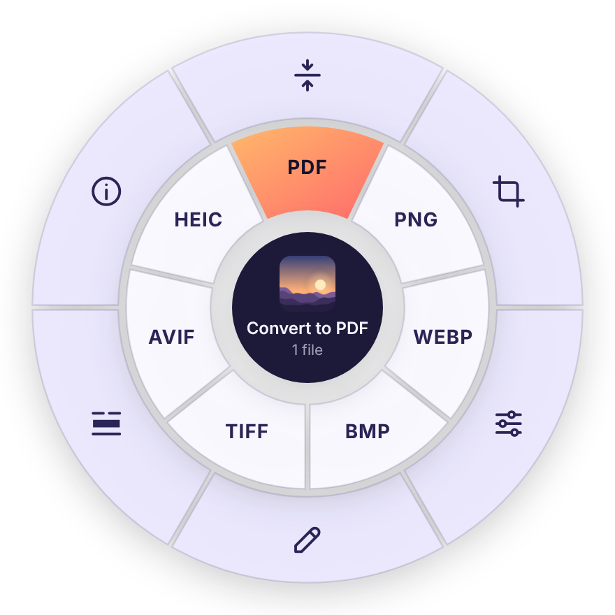
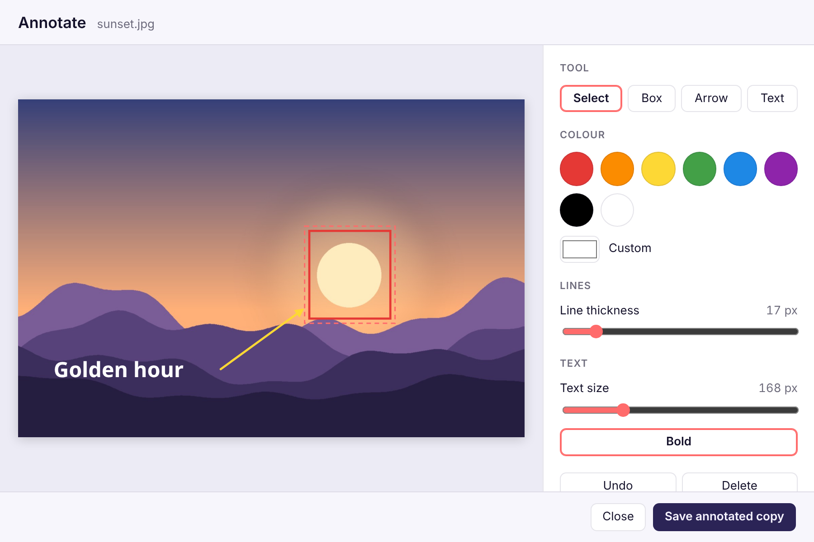
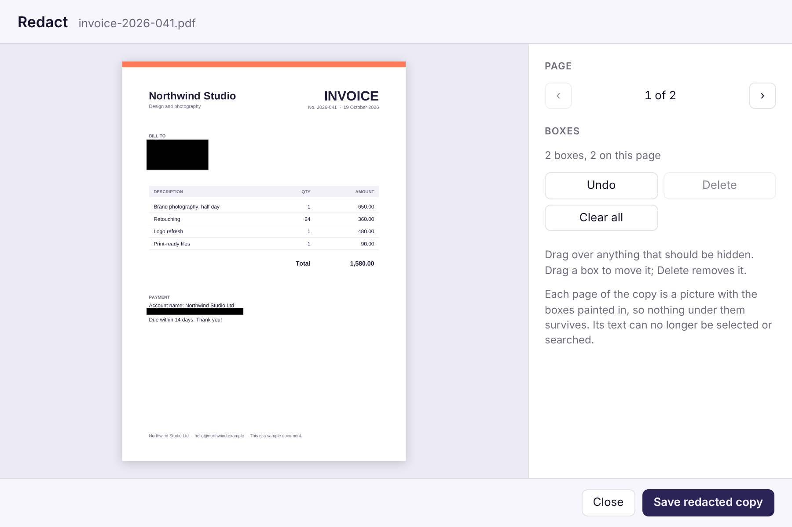
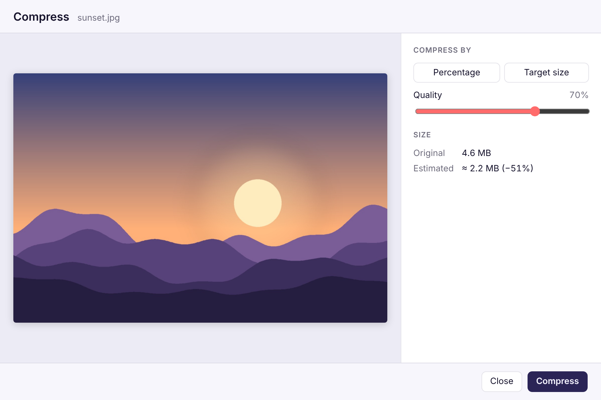
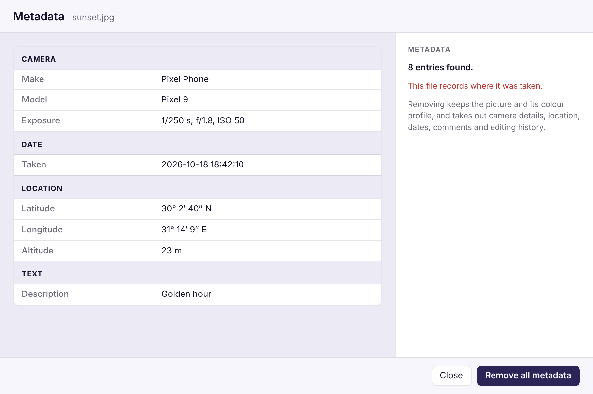
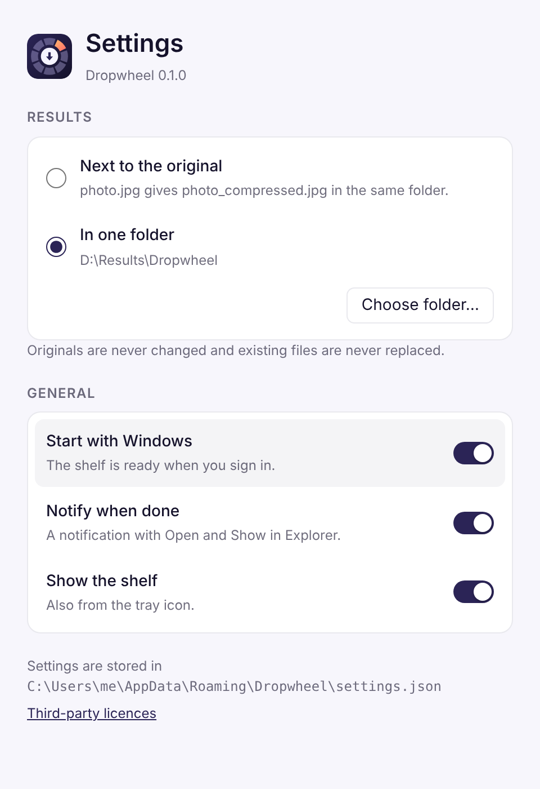

<div align="center">


# Dropwheel

**Drop a file. Pick an action. Done.**

A small Windows tray app that turns everyday file chores (converting, compressing,
cropping, annotating, redacting) into one drag and one click.


<br>

<picture>
  <source media="(prefers-color-scheme: dark)" srcset="docs/images/wheel-dark.png">
  
</picture>

</div>

## Contents

- [Why Dropwheel](#why-dropwheel)
- [Features](#features)
- [How it works](#how-it-works)
- [A closer look](#a-closer-look)
- [What it can do with each file](#what-it-can-do-with-each-file)
- [Install](#install)
- [Using Dropwheel](#using-dropwheel)
- [Privacy and safety](#privacy-and-safety)
- [Building from source](#building-from-source)
- [Architecture](#architecture)
- [Known limitations](#known-limitations)
- [Credits and licences](#credits-and-licences)

## Why Dropwheel

Small file jobs usually mean opening a heavy editor or uploading to a website you don't
know: shrink this photo for an email, turn that PDF into Word, hide an account number
before sharing a scan. Dropwheel keeps a small shelf on your desktop instead. Drop files
on it and a wheel of actions opens right where you let go. It only offers what makes
sense for those files, and it works entirely on your PC.

## Features

- **One gesture.** Drop a file and pick a wedge. Only the actions that fit the file are
  shown.
- **Convert anything common.** Images between JPG, PNG, WEBP, BMP, TIFF, AVIF and HEIC.
  Images to PDF and PDF pages to images. PDF to Word or text, and Word or text to PDF.
- **Compress** photos and PDFs by quality, or down to a target size, with a live estimate
  of the result.
- **Crop and edit** with aspect presets, rotate, flip, black and white, brightness and
  contrast.
- **Annotate** with boxes, arrows and text, in any language, Arabic and other
  right-to-left scripts included.
- **Redact for real.** Black boxes are painted into the pixels, and PDF pages are
  flattened, so what was underneath cannot be recovered.
- **Remove hidden data** such as location, camera details and the names stored in Word
  documents.
- **Many files at once.** Drop several files and the action you pick applies to all of
  them.
- **Safe by design.** Originals are never modified and nothing is ever overwritten.
- **Feels native.** Tray icon, notifications with Open and Show in Explorer, start with
  Windows, and light and dark themes that follow your system.

## How it works

<p align="center">
  <picture>
    <source media="(prefers-color-scheme: dark)" srcset="docs/images/shelf-dark.png">
    
  </picture>
</p>

1. **Drop.** Drag files from Explorer onto the shelf, a small always-on-top square you
   can place anywhere.
2. **Pick.** The wheel opens at the drop point. The inner ring converts; the outer ring
   holds the tools. Hover a wedge to see what it does, then click it.
3. **Done.** The result is saved next to the original, or in a folder of your choice. The
   shelf shows the progress, and Windows tells you when it is ready.

## A closer look

Actions that need choices open a dialog with a live preview.

<table>
  <tr>
    <td width="50%">
      <picture>
        <source media="(prefers-color-scheme: dark)" srcset="docs/images/dialog-annotate-dark.png">
        
      </picture>
      <p align="center"><b>Annotate</b>: boxes, arrows and text, with undo.</p>
    </td>
    <td width="50%">
      <picture>
        <source media="(prefers-color-scheme: dark)" srcset="docs/images/dialog-redact-dark.png">
        
      </picture>
      <p align="center"><b>Redact</b>: page by page, for PDFs too.</p>
    </td>
  </tr>
  <tr>
    <td width="50%">
      <picture>
        <source media="(prefers-color-scheme: dark)" srcset="docs/images/dialog-compress-dark.png">
        
      </picture>
      <p align="center"><b>Compress</b>: see the size before you save.</p>
    </td>
    <td width="50%">
      <picture>
        <source media="(prefers-color-scheme: dark)" srcset="docs/images/dialog-metadata-dark.png">
        
      </picture>
      <p align="center"><b>Metadata</b>: see what a file gives away.</p>
    </td>
  </tr>
</table>

## What it can do with each file

| Dropped file | Convert to | Tools |
| --- | --- | --- |
| **Images**: JPG, PNG, WEBP, BMP, TIFF, GIF, ICO, AVIF, HEIC | PDF and the other image formats | Crop, Edit, Annotate, Redact (all but ICO) · Compress (JPG, PNG, WEBP, AVIF, TIFF) · Metadata (JPG, PNG, WEBP, TIFF, AVIF, HEIC) · Add background (PNG, WEBP, AVIF, TIFF, GIF) |
| **PDF** | DOCX, TXT, JPG, PNG, WEBP, BMP, TIFF | Compress, Crop, Redact, Metadata |
| **Word (DOCX)** | PDF, TXT | Metadata |
| **Text (TXT)** | DOCX, PDF | |

Dropwheel reads a file's type from its content, not its name, so a PNG renamed to `.jpg`
is still treated as a PNG. Results are named after the original and the action:
`photo_compressed.jpg`, `report_converted.docx`, `scan_redacted.pdf`, and so on. If that
name is taken, Dropwheel adds a number, as in `photo_compressed (2).jpg`.

<details>
<summary><b>Image formats in detail</b></summary>

<br>

| Format | Read | Write | Notes |
| --- | --- | --- | --- |
| JPG | Yes | Yes | Progressive and optimised. Photos are turned upright from their EXIF orientation. |
| PNG | Yes | Yes | Compressing below 90% reduces the colours to a palette. |
| WEBP | Yes | Yes | Lossy for photos, lossless for graphics. Animated files: first frame. |
| BMP | Yes | Yes | |
| TIFF | Yes | Yes | Written losslessly. Multi-page files: first page. |
| GIF | Yes | Yes | Animated files: first frame. |
| ICO | Yes | No | Edits of an icon are saved as PNG. |
| AVIF | With Windows' free "AV1 Video Extension" | Yes | Encoding large images is slow. |
| HEIC | With Windows' free "HEIF Image Extensions" | With Microsoft's paid "HEVC Video Extensions" | Without the encoder, HEIC is not offered as a target and HEIC edits are saved as JPG. |

</details>

<details>
<summary><b>Document conversions in detail</b></summary>

<br>

| From | To | Result |
| --- | --- | --- |
| Image | PDF | One A4 page, turned to suit the picture, with the picture centred and never enlarged. JPEGs go in unchanged. |
| PDF | Images | Each page at 200 dpi. Several pages give a folder, `name_pages`, with one file per page. |
| PDF | TXT | The text line by line, with blank lines between paragraphs and pages. |
| PDF | DOCX | Paragraphs, headings, bold, italic and pictures rebuilt. Scanned pages become pictures. |
| DOCX | PDF | Headings, styles, colours, lists, tables, pictures, page breaks and right-to-left text. |
| DOCX | TXT | Paragraphs as lines, list markers kept, table cells separated by tabs. |
| TXT | DOCX, PDF | One paragraph per line. UTF-8, UTF-16 and older Windows encodings are recognised. |

PDFs Dropwheel writes have real, searchable text, set in Noto Sans and IBM Plex Sans
Arabic with Windows fonts for other scripts. On PDFs, Compress shrinks the pictures,
Crop applies the same frame to every page, and Metadata removes the document
information, XMP and private application data.

</details>

## Install

**Requirements:** Windows 10 or 11, 64-bit, with the Microsoft Edge WebView2 Runtime.
Windows 11 includes it, and most Windows 10 PCs have it; both installers fetch it if it
is missing.

- **Installer** (`Dropwheel_<version>_x64-setup.exe`), recommended. Installs for your user
  only, without admin rights, with a Start menu entry and a clean uninstaller.
- **MSI** (`Dropwheel_<version>_x64_en-US.msi`), for installing for every user of a PC.
- **Portable** (`dropwheel.exe`), for running from any folder or a USB stick without
  installing.

There is no published release yet. Every CI run builds all three and attaches them to
the run as the `dropwheel-windows-x64` artifact (see the Actions tab), or you can build
them yourself as described below.

> [!NOTE]
> The builds are not code-signed yet, so Windows SmartScreen may warn before the first
> run. Choose **More info**, then **Run anyway**.

## Using Dropwheel

**The shelf.** Drag it anywhere; it remembers where you left it. Click the tray icon to
show or hide it, or right-click it for Settings and Quit.

**The wheel.** Hover a wedge to read its name in the centre, then click it. Press Esc or
click outside the wheel to close it. Actions such as Compress or Redact open a dialog;
simple ones, such as converting, start straight away.

**Settings.** Open them from the tray menu. Changes apply at once.

<p align="center">
  <picture>
    <source media="(prefers-color-scheme: dark)" srcset="docs/images/settings-dark.png">
    
  </picture>
</p>

- **Results**: save next to the original, or collect everything in one folder.
- **Start with Windows**: the shelf is ready when you sign in. No admin rights needed.
- **Notify when done**: a Windows notification with **Open** and **Show in Explorer**.
  The buttons keep working from the notification centre, even after Dropwheel has quit.
- **Show the shelf**: the same as the tray menu's Show/Hide.

<details>
<summary><b>Keyboard shortcuts</b></summary>

<br>

| Where | Keys | Action |
| --- | --- | --- |
| Wheel | Arrow keys | Move between wedges |
| Wheel | Enter or Space | Run the selected action |
| Wheel | Esc | Close |
| Annotate, Redact | Ctrl+Z | Undo |
| Annotate, Redact | Delete | Remove the selected shape |
| Annotate | Enter / Shift+Enter | Finish the text / start a new line |
| Redact (PDF) | Page Up / Page Down | Previous / next page |
| Crop | Arrow keys (with Shift: ×10) | Nudge the crop frame |
| Dialogs, Settings | Esc | Close |

</details>

## Privacy and safety

- **Nothing leaves your PC.** There are no uploads, accounts or telemetry, and the app
  contains no networking code. PDF support and the fonts are built in.
- **Originals stay untouched.** Every action writes a new file, and existing files are
  never replaced.
- **Redaction is permanent.** Boxes are burned into the pixels, and redacted copies carry
  none of the original's metadata. PDF pages are flattened to images, so hidden text
  cannot be copied out.
- **Links are locked down.** The notification buttons use a `dropwheel:` link that can
  only show a file in Explorer or open a file Dropwheel itself created, so a web page
  cannot use it to open anything else.

<details>
<summary><b>Everything Dropwheel stores on your PC</b></summary>

<br>

| Location | Contents |
| --- | --- |
| `%APPDATA%\Dropwheel\settings.json` | Settings, including the shelf position |
| `%LOCALAPPDATA%\io.github.mohamed0hussein.dropwheel\logs\` | Log files |
| `%LOCALAPPDATA%\io.github.mohamed0hussein.dropwheel\EBWebView\` | WebView2 data |
| `%LOCALAPPDATA%\io.github.mohamed0hussein.dropwheel\pdfium\` | The PDF engine, unpacked from the exe on first start |
| `%LOCALAPPDATA%\io.github.mohamed0hussein.dropwheel\results.json` | The last 200 results, which a notification may open |
| `%LOCALAPPDATA%\io.github.mohamed0hussein.dropwheel\notification-icon.png` | The icon shown on notifications |

In the registry, under `HKEY_CURRENT_USER` only:

| Key | Purpose |
| --- | --- |
| `Software\Microsoft\Windows\CurrentVersion\Run`, value `Dropwheel` | Start with Windows, when it is on |
| `Software\Classes\AppUserModelId\io.github.mohamed0hussein.dropwheel` | The name and icon on notifications |
| `Software\Classes\dropwheel` | The links behind the notification buttons |

The installer's uninstaller removes these registry entries and, if you tick its box, the
`%LOCALAPPDATA%` folder. Your settings in `%APPDATA%\Dropwheel` stay until you delete
them. A settings file that cannot be read is set aside as `settings.json.bad`, and
Dropwheel starts with defaults.

</details>

## Building from source

### Prerequisites

- [Rust](https://rustup.rs) 1.92 or newer with the MSVC toolchain, plus the Visual Studio
  Build Tools with the "Desktop development with C++" workload.
- [Node.js](https://nodejs.org) 20.19+ or 22.12+ (`winget install OpenJS.NodeJS.LTS`).
- The WebView2 Runtime.

### Run in development

Quit any installed copy first: only one Dropwheel runs at a time.

```powershell
cd ui
npm install
npm run tauri dev
```

The first run downloads PDFium (about 4 MB, pinned and checksum-verified) into
`vendor/pdfium` and compiles for a few minutes. Afterwards the app reloads as you edit.
To skip dragging files while working on the wheel, list them in `DROPWHEEL_DEV_DROP` and
development builds open the menu for them at startup:

```powershell
$env:DROPWHEEL_DEV_DROP = "C:\Users\me\Pictures\photo.jpg;C:\Users\me\report.pdf"
npm run tauri dev
```

### Release build

```powershell
cd ui
npm run tauri build
```

This produces the portable `target\release\dropwheel.exe`, the NSIS installer in
`target\release\bundle\nsis\` and the MSI in `target\release\bundle\msi\`. The exe is
self-contained: PDFium, the fonts and the interface are all inside it.

To build on Linux without a Windows machine, `scripts/build-windows-on-linux.sh`
cross-compiles with MinGW and produces the NSIS installer and a portable zip. A MinGW
build needs `WebView2Loader.dll` beside the exe; the zip and the installer include it.

### Checks

```powershell
cargo fmt --all --check
cargo clippy --workspace --all-targets -- -D warnings
cargo test --workspace
python scripts/make-notices.py --check
cd ui
npm run typecheck
npm test
```

CI runs all of these on Windows for every push, then builds the installers and the
portable exe ([`.github/workflows/ci.yml`](.github/workflows/ci.yml)). After changing
dependencies, run `python scripts/make-notices.py` to refresh the licence notices.

## Architecture

```
dropwheel/
├─ crates/core/     All file processing, in plain Rust: no UI, fully unit tested
├─ crates/wic/      Windows Imaging Component bindings for HEIC and AVIF
├─ src-tauri/       The desktop app: tray, windows, jobs, settings, notifications
├─ ui/              The interface: TypeScript and Vite, one page per window
├─ scripts/         PDFium download, icon generator, notices, Linux cross-build
├─ docs/images/     Screenshots for this README
├─ DECISIONS.md     Why things are built the way they are
└─ THIRD-PARTY-NOTICES.txt
```

Every action in the menu is one implementation of a single trait in `dropwheel-core`.
The app finds the actions that fit the dropped files, runs the chosen one on a
background thread and reports progress to the shelf:

```rust
pub trait Action: Send + Sync {
    fn id(&self) -> &'static str;
    fn label(&self) -> &'static str;
    fn group(&self) -> ActionGroup;
    fn applicable(&self, kind: FileKind) -> bool;
    fn run(&self, input: &Path, opts: &Options, out: &Path) -> Result<PathBuf>;
}
```

| Area | Built with |
| --- | --- |
| App shell | [Tauri 2](https://tauri.app) on WebView2 |
| Interface | TypeScript and Vite, without a framework; the wheel is SVG |
| Images | `image`, `jpeg-encoder`, libwebp, `ravif`, and Windows codecs for HEIC and AVIF |
| PDF | PDFium (reading and rendering), `krilla` (writing), `lopdf` (editing) |
| Word | `zip` and `quick-xml`, with a small document model shared with PDF and TXT |
| Text and drawing | `rustybuzz`, `unicode-bidi` and `tiny-skia`, with bundled fonts |
| Windows integration | The `windows` crate: notifications, registry, Explorer |

[DECISIONS.md](DECISIONS.md) records the reasoning behind each choice.

## Known limitations

- **Windows only.** The code also builds on Linux, for development checks.
- **PDF to Word** rebuilds paragraphs, headings and pictures, but not tables, columns or
  the exact layout. There is no text recognition (OCR) for scans.
- **Word to PDF** leaves out headers, footers, footnotes, comments and charts, and uses
  the bundled fonts instead of the document's.
- **Redacted PDFs** are images of their pages, so they are larger and their text can no
  longer be selected.
- **Password-protected PDFs** are refused rather than opened.
- **HEIC and AVIF** need Microsoft's free Store extensions to open, and saving as HEIC
  needs the paid HEVC extension.

<details>
<summary><b>All known limitations</b></summary>

<br>

- Conversions and edits keep the colour profile but not EXIF data, since the orientation
  is applied to the pixels. Use Metadata to strip data deliberately.
- Images with 16 bits per channel are saved with 8. Animated GIF and WEBP, and
  multi-page TIFF, are reduced to their first frame or page.
- Cropping a PDF hides the rest of each page without deleting it, as PDF viewers' own
  crop does. Use Redact to remove content.
- PDF compression only recompresses pictures. Fonts and other content are repacked but
  not rewritten.
- Italic text in generated PDFs is slanted Noto Sans, since no italic face is bundled.
  Emoji are drawn as plain glyphs where Windows fonts have them.
- Pictures in Windows metafile formats (EMF, WMF) are skipped when converting Word to
  PDF.
- Notifications follow Windows' Do Not Disturb and notification settings. Open works for
  the last 200 results; Show in Explorer always works.
- If the shelf is hidden, it still flashes briefly at startup. This works around a
  WebView2 bug that blocks file drops on windows created hidden.
- Uninstalling the MSI leaves the per-user registry entries listed above; the NSIS
  uninstaller removes them.
- Some Windows behaviour has not yet been verified by hand on every Windows version:
  Alt+Tab exclusion, the shelf position across monitors, HEIC and AVIF through Windows'
  codecs, notifications, starting with Windows and the uninstall steps. Please open an
  issue if anything looks wrong.

</details>

## Credits and licences

Dropwheel stands on excellent open-source work:

- [PDFium](https://pdfium.googlesource.com/pdfium/) (BSD), in the build by Benoit
  Blanchon's [pdfium-binaries](https://github.com/bblanchon/pdfium-binaries), including
  FreeType. Portions of this software are copyright © The FreeType Project
  (www.freetype.org). All rights reserved.
- This software is based in part on the work of the Independent JPEG Group.
- [libwebp](https://chromium.googlesource.com/webm/libwebp) by Google (BSD).
- [Noto Sans](https://fonts.google.com/noto) © The Noto Project Authors and
  [IBM Plex Sans Arabic](https://github.com/IBM/plex) © IBM Corp., both under the SIL
  Open Font License 1.1.
- [Tauri](https://tauri.app) and hundreds of Rust crates under MIT, Apache-2.0, BSD and
  similar licences. A few that Tauri uses (`cssparser`, `selectors`, `dtoa-short`,
  `option-ext`) are under the Mozilla Public License 2.0, unchanged from crates.io.

[THIRD-PARTY-NOTICES.txt](THIRD-PARTY-NOTICES.txt) holds every licence text and copyright
notice; the app shows it under Settings → Third-party licences.

Dropwheel's own code has no licence yet, so all rights are reserved by the author until
one is chosen.

<details>
<summary><b>Renaming the app</b></summary>

<br>

"Dropwheel" is a working name. To rename the product, change:

- `src-tauri/tauri.conf.json`: `productName` (window titles, tray tooltip and the
  `%APPDATA%` folder) and `identifier`.
- `ui/*.html`: the page titles.
- `src-tauri/src/integration.rs` (`SCHEME`) and `src-tauri/windows/hooks.nsh`: the
  `dropwheel:` link scheme.
- Optionally, the crate and package names (`dropwheel`, `dropwheel-core`,
  `dropwheel-ui`).

`git grep -i dropwheel` lists every occurrence.

</details>
